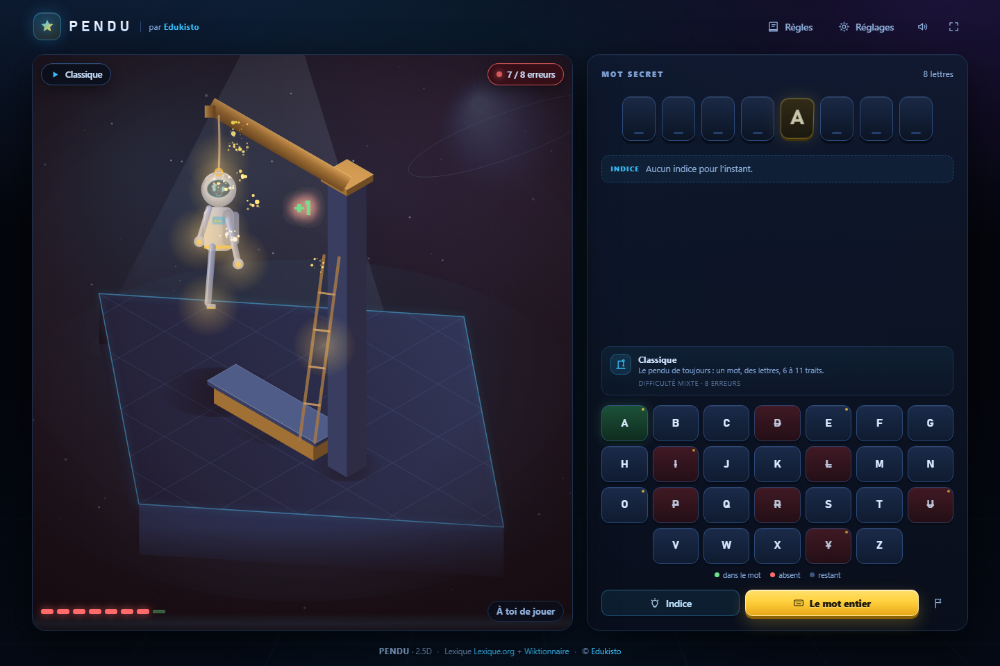
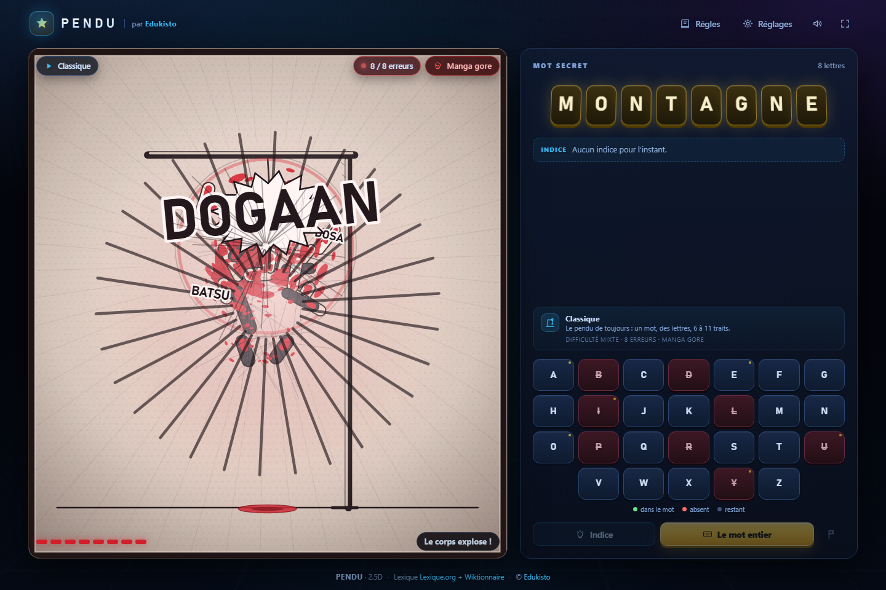
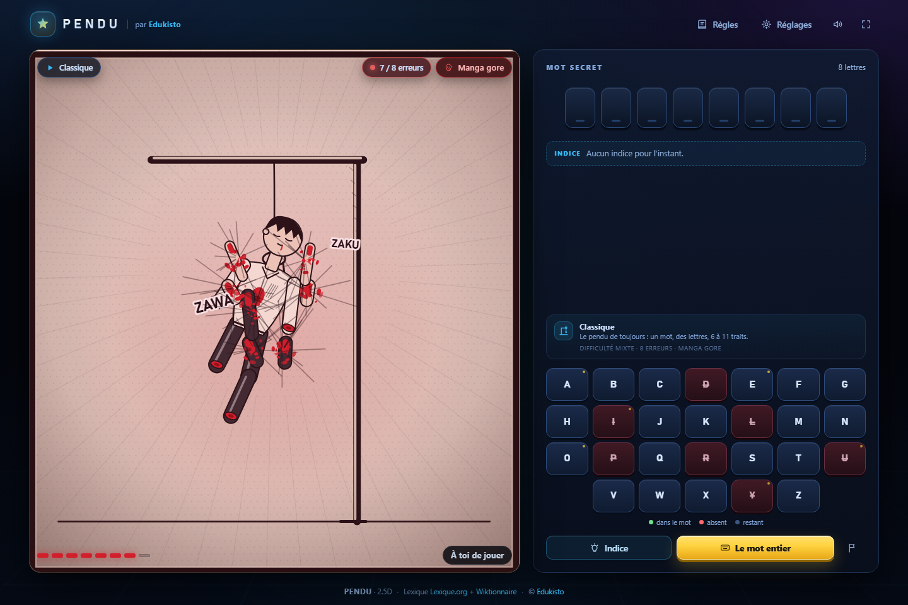

# PENDU — le jeu du pendu en 2.5D

Le pendu, en **2.5D**, avec huit mécaniques de jeu, un lexique français filtré de **9 502 noms
communs**, une définition à chaque fin de manche et une charte **Edukisto**
(nuit profonde, cyan `#38bdf8`, or `#ffd23f`).

Jouable **seul** (l’ordinateur choisit le mot) ou **à deux** (un meneur, un devineur),
sans compte, sans serveur : tout tient dans trois fichiers statiques.

> 🎮 **En ligne** : déployé automatiquement par **Cloudflare Pages** depuis ce dépôt
> (`fireman358/pendu`, branche `main`), servi sur le domaine Edukisto.



---

## 🎯 Les huit mécaniques

| Mode | Ce que ça change |
|---|---|
| **Classique** | Le pendu de référence : un mot, des lettres, 6 à 11 traits. |
| **Par catégorie** | Le thème est annoncé : animaux, pays, métiers, nourriture, films. |
| **Phrases & titres** | On devine une expression, un proverbe, un film ou une chanson. |
| **Avec indices** | Indice gratuit après 3 erreurs, ou immédiat contre un trait de pénalité. |
| **Chronométré** | Temps limité par proposition (10, 20 ou 30 s). |
| **Inversé** | La potence est déjà dessinée : chaque lettre trouvée retire un crochet, chaque erreur en remet un. Un « cri au bluff » une fois par manche. |
| **Dedans-dehors** | Il faut alterner une lettre présente dans le mot et une lettre absente. |
| **Diabolique** | L’ordinateur ne fixe pas le mot : à chaque lettre, il garde la famille de mots qui vous désespère le plus (*evil hangman*). |

### Les règles de base

Un mot secret est choisi, un tiret s’affiche par lettre.

- **Lettre présente** : elle s’écrit à toutes ses positions.
- **Lettre absente** : un trait du dessin s’ajoute.
- **Mot complété** : victoire du devineur.
- **Dessin terminé** : victoire du meneur.

Le nombre d’erreurs (6 à 11 traits, potence comprise ou non) se règle dans
**Réglages**. Un rappel des règles s’affiche à l’ouverture.

### Les options de partie

- **Sans répétition** — une lettre déjà dite compte comme une erreur.
- **Première et dernière lettre offertes** — version facilitée pour les enfants.
- **Voyelles limitées** — trois voyelles proposables au maximum.
- **Indice contre pénalité** — chaque indice coûte un trait.
- **Deviner le mot entier** — une tentative, tentatives illimitées à un trait chacune, ou interdit.
- **Temps par proposition** — 10, 20, 30 s ou illimité.
- **Difficulté** — facile, moyen, difficile, ou mixte.
- **Version gore (manga)** — peau de scène sanglante, désactivée par défaut (voir plus bas).

### À deux

Le meneur saisit son mot (et, s’il le souhaite, un thème, une définition et le nombre
d’erreurs) derrière un écran de confidence. Le devineur joue, puis les rôles s’inversent :
le tableau des scores suit les manches.

### Apprendre en jouant

À chaque fin de manche — gagnée ou perdue — le mot s’affiche avec sa **définition**
et sa source. Les statistiques (série, record) restent dans le navigateur.

### Les réglages

Le panneau est organisé en quatre onglets :

| Onglet | Contenu |
|---|---|
| **Jeu** | difficulté, nombre d’erreurs, temps par proposition, mot entier, options de partie |
| **Ambiance** | son et vibrations, version gore (manga) |
| **Application** | installation PWA, version, liens |
| **Données** | statistiques, remise à zéro des mots vus, des statistiques ou de tout |

Deux niveaux de remise à zéro : **Réinitialiser les réglages** (en bas du panneau) remet
toutes les préférences par défaut sans toucher aux statistiques ; **Tout effacer**
(onglet Données) supprime réglages, statistiques et index de consommation des mots,
après confirmation.

### Variante manga gore (option, désactivée par défaut)

Une peau de scène à activer dans **Réglages → Version gore (manga)**, après confirmation.
Le condamné est **déjà pendu** ; chaque erreur sectionne un membre — mains, pieds,
avant-bras, mollets, bras, cuisses — dans un style manga : papier et trame, trait d’encre,
sang en aplats rouges, onomatopées, traits de vitesse. Le corps **se balance au bout de la
corde** à chaque sectionnement, avec un à-coup et une gerbe de gouttes.

Le reste du jeu (mots, définitions, règles, chrono, indices) est strictement identique.
La variante est **désactivée par défaut** et n’est pas proposée en mode inversé, qui garde
le dessin classique.

**Au dernier coup, le corps explose** : éclat blanc dentelé, onomatopée géante, traits de
vitesse radiaux, onde de choc, morceaux projetés, éclaboussures et tache qui reste sur le
papier — la planche manga complète, avant l’écran de fin.





---

## 🧠 Le lexique

Le fichier `data/mots.txt` (un mot par ligne, MAJUSCULES, sans accents) est produit par
`tools/build_mots.py` à partir de deux ressources libres :

1. **[Lexique.org 3.83](https://www.lexique.org)** (CC BY-SA 4.0) — formes, catégories
   grammaticales, genre, nombre, fréquences.
2. **[Wiktionnaire francophone](https://fr.wiktionary.org)** (CC BY-SA 3.0) — définitions
   en français et catégories thématiques, via l’API MediaWiki.

Le jeu embarque **9 502 mots**, répartis en 3 366 faciles, 3 774 moyens et 2 362 difficiles.
### Filtrage appliqué

- noms communs au **singulier** uniquement (`cgram = NOM`, `nombre = s`, `lemme = ortho`) ;
- verbes, conjugaisons, pluriels, formes fléchies, noms propres, sigles, mots composés
  et abréviations exclus ;
- longueur finale **5 à 12 lettres** (après suppression des accents) ;
- seuls les caractères `A` à `Z` subsistent (`œ` → `OE`, `æ` → `AE`) ;
- fréquence minimale (somme des fréquences livres + films de Lexique) pour écarter les
  régionalismes méconnus, les emprunts rares et le vocabulaire trop spécialisé ;
- listes d’exclusion : injures et grossièretés, vocabulaire médical ou scientifique
  pointu, termes régionaux obscurs, noms propres glissés dans les noms communs ;
- une définition française courte (Wiktionnaire) est exigée pour chaque mot retenu,
  avec rejet des renvois du type « variante de », « pluriel de », « forme de ».

### Notation de difficulté

Chaque mot reçoit un score de 0 à 1, calculé automatiquement :

```
rareté des lettres  = 1 − moyenne(poids des lettres) / 10
                      poids : E 10 · A 9,2 · S 8,4 · I 7,6 · N 6,8
                              T 6 · R 5,2 · U 4,4 · O 3,6 · L 2,8 · autres 1,2
pénalité de voyelles = proportion de voyelles sous 30 %
lettres distinctes   = plus il y en a, plus le mot est difficile
fréquence            = plus le mot est rare, plus il est difficile

score = 0,45 × rareté + 0,20 × voyelles + 0,20 × distinctes + 0,15 × fréquence
```

- **Facile** : score < 0,375 — mots courants, lettres fréquentes, au moins deux voyelles.
- **Moyen** : 0,375 ≤ score < 0,46.
- **Difficile** : score ≥ 0,46 — lettres rares, peu de voyelles, beaucoup de lettres distinctes.

L’index de consommation est conservé dans `localStorage` : un jeu de mots mélangé et sa
position sont mémorisés par difficulté, si bien qu’on ne retombe pas sur les mêmes mots
d’une visite à l’autre, et qu’on ne les revoit qu’une fois tout le paquet épuisé.

### Régénérer les données

```bash
python tools/build_mots.py --fetch   # télécharge les définitions (cache local)
python tools/build_mots.py --build   # écrit data/mots.txt, data/mots.json, assets/lexique.js
```

Les fichiers générés (`data/mots.txt`, `data/mots.json`, `assets/lexique.js`) sont
versionnés : le jeu fonctionne sans relancer le script.

---

## 🗂 Structure

```
index.html              page unique (accueil, plateau, règles, réglages, modales)
manifest.webmanifest    manifeste PWA (nom, icônes, mode standalone)
sw.js                   service worker (cache de la coquille, hors ligne)
_headers                en-têtes Cloudflare Pages (cache, sécurité)
assets/
  style.css             charte Edukisto (variables CSS, 2.5D, responsive)
  scene.js              rendu 2.5D isométrique (potence, astronaute, lumière, particules)
  gore.js               variante manga gore (corps pendu, sectionnements, sang)
  game.js               moteur : modes, indices, chrono, paquet, localStorage
  lexique.js            données générées (mots + définitions + difficulté)
  annexes.js            pays, films, expressions, proverbes, chansons
data/
  mots.txt              lexique final (un mot par ligne, MAJUSCULES, sans accents)
  mots.json             index complet (définitions, thèmes, scores)
assets/img/             icônes PWA et image de partage
tools/
  build_mots.py         pipeline Lexique.org + Wiktionnaire
  make_assets.py        génération des icônes et de l’image de partage
  test_game.py          tests de fumée dans Chromium headless
```

---

## ▶️ Lancer le jeu

Aucune dépendance, aucun build. Trois façons :

```bash
# 1. double-clic sur index.html (les scripts sont classiques, pas de modules ES)

# 2. petit serveur local
python -m http.server 8080        # puis http://localhost:8080

# 3. n’importe quel serveur statique
npx serve .
```

> **Publier une nouvelle version** : `python tools/bump_version.py 1.3.0` met à jour le
> paramètre `?v=` des assets, le cache du service worker et la version affichée. À lancer
> avant chaque déploiement qui touche `assets/` ou `index.html`.

## 📲 Installer l’application
Le jeu est une **PWA** : une fois servi en HTTPS (Cloudflare), il peut s’installer sur
l’écran d’accueil et fonctionner **hors ligne**.

- **Android / Chrome / Edge** : bouton **Installer** dans l’en-tête ou dans
  *Réglages → Application*, ou menu du navigateur → « Installer l’application ».
- **iPhone / iPad (Safari)** : *Partager* → **Sur l’écran d’accueil**.
- **Ordinateur** : icône d’installation dans la barre d’adresse, ou le bouton **Installer**.

Une fois lancée en mode application, la page s’ouvre en plein écran ; le **service worker**
(`sw.js`) garde la coquille, le lexique et les définitions en cache, donc une partie peut
démarrer sans connexion. Les mises à jour sont récupérées en arrière-plan au chargement
suivant.

> L’installation n’est proposée qu’en HTTPS (ou sur `localhost`) : ouvrir `index.html`
> en double-clic fonctionne, mais sans installation ni mode hors ligne.

**Mises à jour** : les fichiers sont appelés avec un paramètre de version (`?v=1.2.0`) et le
service worker sert toujours le réseau en priorité, si bien qu’un simple rechargement
récupère la dernière version. En cas de page vide après un déploiement (anciens scripts en
cache), recharger avec **Ctrl+Maj+R** ou utiliser **Réglages → Application → Forcer la mise
à jour**.

## 🚀 Déploiement (Cloudflare Pages)

Le dépôt `github.com/fireman358/pendu` est relié à **Cloudflare Pages**, qui reconstruit et
publie automatiquement à chaque push sur `main`. Aucun build n’est nécessaire : le site est
100 % statique.

Réglages Cloudflare Pages :

| Champ | Valeur |
|---|---|
| Framework preset | *None* |
| Build command | *(vide)* — ou `exit 0` |
| Build output directory | `/` |
| Root directory | `/` |
| Branche de production | `main` |

Le fichier [`_headers`](_headers) règle le cache et quelques en-têtes de sécurité au niveau
de Cloudflare. Le domaine Edukisto pointe vers ce projet Pages ; les pushs suivants sont
déployés sans intervention.

---

## 🎨 Charte Edukisto

| Rôle | Couleur |
|---|---|
| Fond nuit | `#05070f` |
| Panneaux | `#0d1526`, `#101a30` |
| Lignes | `#24406b` |
| Texte | `#e8f0fc` |
| Accent or | `#ffd23f` |
| Accent cyan | `#38bdf8` |
| Succès / erreur | `#6fe08a` / `#ff6b6b` |

Typographie système (`Segoe UI`, `Bahnschrift` pour les titres), rayons généreux,
ombres profondes, verre dépoli, étoile à cinq branches comme marque.

## 📄 Licences

- Code du jeu : **MIT** — voir [LICENSE](LICENSE).
- Lexique : **Lexique.org 3.83**, CC BY-SA 4.0.
- Définitions : **Wiktionnaire francophone**, CC BY-SA 3.0.
- Contenus éditoriaux (pays, films, expressions) : © Edukisto.

Les données dérivées (`data/mots.txt`, `data/mots.json`, `assets/lexique.js`) restent
soumises aux licences CC BY-SA de leurs sources.
