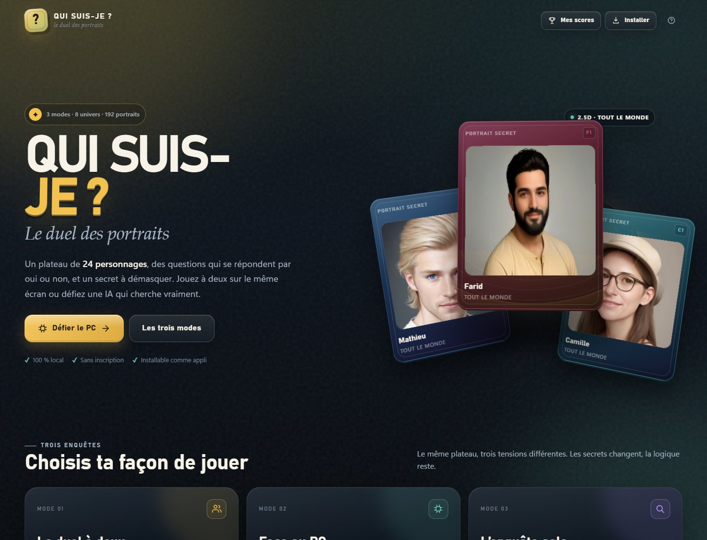

# Qui suis-je ? — Le duel des portraits

Application web **100 % côté client** du jeu *Qui suis-je ?*, en français, avec un plateau de **24 personnages** par univers et huit thèmes complets. Le rendu est en **2.5D** : cartes inclinées, profondeur, halo de scène, plateau en perspective et animations discrètes.

Le nom **Qui suis-je ?** distingue cette création de la marque déposée du jeu de plateau dont elle s'inspire.

Aucun backend, aucune inscription et **aucune requête vers un service tiers à l'exécution**. Les 192 portraits sont stockés localement dans `assets/portraits/` et pré-cachetés par le service worker. Les scores, séries, options et thèmes sont conservés dans le `localStorage` du navigateur.



---

## Lancer le jeu

### 1. Ouverture directe (le plus rapide)

Double-clique sur **`index.html`**.

Le jeu fonctionne immédiatement, y compris sans connexion. Ce mode utilise le bundle local `data/themes.bundle.js` généré à partir des fichiers JSON. L'installation PWA et le service worker ne sont pas disponibles en `file://`, c'est la seule limite.

### 2. Serveur statique local (recommandé pour la PWA)

Sous Windows, double-clique sur **`demarrer.cmd`**. Le navigateur s'ouvre sur `http://127.0.0.1:8080/`.

En ligne de commande :

```bash
npm start
# ou : node serve.mjs 8080
# ou : python -m http.server 8080 --bind 127.0.0.1
```

Puis ouvre <http://127.0.0.1:8080/>.

Ce serveur ne contient **aucune logique de jeu** : il sert uniquement à fournir un contexte `http://localhost` sécurisé pour le service worker et l'installation PWA.

### 3. Installation en application

Une fois le jeu ouvert depuis `localhost` ou un hébergement HTTPS :

- **Chrome / Edge / Chromium** : icône d'installation dans la barre d'adresse, ou menu → *Installer Qui suis-je ?*.
- **iPhone / iPad** : Safari → bouton *Partager* → *Sur l'écran d'accueil*.

Après la première visite en ligne, le service worker met en cache l'application, les huit thèmes, les 192 portraits et les icônes. Le jeu se lance ensuite hors connexion.

---

## Les trois modes

### Mode 1 — Deux joueurs sur le même PC (hot-seat)

1. Chaque joueur choisit son secret à l'abri des regards.
2. Trois mécanismes anti-spoil sont proposés :
   - un **écran de passation** « Passe le PC à … » entre les deux sélections ;
   - un **tirage aléatoire**, dont le portrait peut être vérifié en maintenant un bouton (relâché = masqué) ;
   - la **saisie d'un code de case** (`A1` à `F4` pour 24 portraits), sans affichage du personnage.
3. Un seul écran, deux **plateaux de déduction séparés** : chacun élimine ses propres portraits.
4. À tour de rôle : question générée depuis un attribut → réponse oui/non de l'adversaire → élimination des portraits → passation.
5. **Deviner qui** : une bonne annonce gagne la manche, une mauvaise la perd immédiatement.
6. Un clic sur une carte ouvre sa **fiche complète** (arbitrage des disputes).

Le format peut être une manche sèche, un premier à 3 ou un premier à 5.

### Mode 2 — Duel contre le PC

- Le PC tire un personnage secret et répond honnêtement aux questions du joueur.
- Le PC pose aussi ses questions sur le secret du joueur. Sa stratégie est une **recherche dichotomique** : parmi ses candidats restants, il choisit l'attribut dont le ratio oui/non est le plus proche de 50 %, filtre après la réponse, puis recommence.
- Trois niveaux :
  - **Facile** : attribut aléatoire ;
  - **Moyen** : une question aléatoire, une question dichotomique, en alternance ;
  - **Difficile** : dichotomie pure.
- En difficile, l'option **bluff** autorise un unique mensonge dans la partie. L'IA attend un moment où la question divise fortement les hypothèses du joueur et où son plateau est suffisamment entamé, puis inverse sa réponse. Le bluff n'est révélé qu'à la fin du match.
- Le joueur répond aux questions du PC avec les boutons **Oui / Non**.
- Dès qu'un seul candidat reste, le PC annonce. Le premier à 3 (ou 5) victoires remporte le match.

### Mode 3 — Mystère solo

Le PC tire un secret, le joueur doit le trouver. Le PC ne pose aucune question.

Sous-modes :

| Sous-mode | Contrainte |
| --- | --- |
| **Libre** | Questions illimitées |
| **Compteur** | 10, 8 ou 6 questions avant obligation de deviner |
| **Trois vies** | Trois annonces possibles, chaque erreur coûte une vie |
| **Chrono** | Plateau complet, 60/90/120 secondes |

- Le joueur clique un attribut : la question est générée automatiquement et le PC répond oui/non.
- L'élimination est manuelle par défaut ; l'option **Élimination assistée** permet au jeu d'écarter automatiquement les portraits compatibles.
- **Mode série** : les manches gagnées s'enchaînent, le score de série et la meilleure série sont enregistrés dans `localStorage`.

---

## Règles et options transverses

- Chronomètre de tour activable/désactivable (60 s par défaut, réglages 30/60/90 s) en modes hot-seat et duel.
- Compteur de questions visible en permanence.
- Journal complet des questions, réponses et annonces, consultable pendant la partie et depuis l'écran de résultat.
- Élimination assistée optionnelle dans les trois modes.
- Portraits éliminés grisés, fiche personnage, mise en évidence du secret, confettis et bandeau de victoire/défaite.
- Thème et options mémorisés ; scores, séries et records conservés localement.
- Interface entièrement en français, responsive desktop/mobile, navigation clavier et respect de `prefers-reduced-motion`.

---

## Les huit thèmes

Tous les thèmes contiennent **24 personnages** et leurs attributs sont définis dans des fichiers JSON séparés :

| Thème | Fichier | Spécificité |
| --- | --- | --- |
| Tout le monde | `data/themes/classique.json` | Le plateau classique : femmes et hommes, cheveux roux/blonds/bruns/noirs, teints clairs à noirs, yeux, lunettes, barbe, chapeau, boucles d'oreilles, taches de rousseur, sourire |
| Animaux | `data/themes/animaux.json` | Classes, habitats, domestique/sauvage, rayures, taches, vol, nage |
| Star Wars | `data/themes/star-wars.json` | Humain, casque, droïde, sabre laser, côté obscur, robe, pilote, Force |
| Nourriture | `data/themes/nourriture.json` | Sucré/salé, fruit/légume/plat, chaud/froid, couleur, origine — classiques belges inclus |
| Harry Potter | `data/themes/harry-potter.json` | Maisons, professeurs, Ordre du Phénix, Mangemorts, créatures |
| Marvel | `data/themes/marvel.json` | Avengers, Gardiens, X-Men, pouvoirs, technologies, mutants |
| DC Comics | `data/themes/dc-comics.json` | Justice League, Gotham, aliens, magie, Bat-Famille |
| Le Seigneur des Anneaux | `data/themes/seigneur-des-anneaux.json` | Peuples, Communauté, magie, royauté, Anneau, archers |

Le thème actif s'applique instantanément à l'accueil, à la scène d'aperçu et aux parties.

---

## Ajouter un thème

1. Crée un fichier JSON dans `data/themes/`, par exemple `mon-theme.json`.
2. Ajoute une entrée correspondante dans `data/themes/index.json`.
3. Regénère le bundle utilisé en ouverture directe et mets à jour le cache PWA :

```bash
npm run build:themes
npm run validate
```

4. Si tu utilises le mode installé, incrémente `VERSION` dans `service-worker.js` pour forcer le renouvellement du cache, et ajoute éventuellement le nouveau JSON à `FICHIERS_APPLICATION`.

Le format est volontairement simple :

```json
{
  "id": "mon-theme",
  "nom": "Mon thème",
  "sousTitre": "Une phrase courte",
  "description": "Description affichée sur l'accueil.",
  "emoji": "🎲",
  "palette": {
    "accent": "#ffcc66",
    "accent2": "#66e0c2",
    "fond": "#0b1418",
    "lueur": "#ffcc66"
  },
  "attributs": [
    {
      "id": "lunettes",
      "nom": "Lunettes",
      "type": "bool",
      "categorie": "Apparence",
      "icone": "👓",
      "question": "Ton personnage porte-t-il des lunettes ?"
    },
    {
      "id": "maison",
      "nom": "Maison",
      "type": "enum",
      "categorie": "Origine",
      "icone": "🏠",
      "options": [
        { "id": "nord", "nom": "Nord", "question": "Ton personnage vient-il du Nord ?" },
        { "id": "sud", "nom": "Sud", "question": "Ton personnage vient-il du Sud ?" }
      ]
    }
  ],
  "personnages": [
    {
      "id": "personnage-1",
      "nom": "Nom affiché",
      "emoji": "🦊",
      "attributs": { "lunettes": true, "maison": "nord" }
    }
  ]
}
```

Contraintes vérifiées par le script :

- 24 ou 48 personnages ;
- identifiants uniques ;
- toutes les valeurs d'attributs renseignées et valides ;
- chaque attribut booléen et chaque option d'énumération signalés s'ils sortent de la zone **25–75 %** du plateau.

Les avertissements d'équilibre ne bloquent pas le chargement : ils sont affichés dans la console du navigateur et dans la sortie de `npm run validate`. Certains attributs sont volontairement rares (par exemple *Nain*, *Droïde* ou *Non humain*), ce qui est acceptable pour un thème donné ; le script sert à les repérer.

---

## Structure du projet

```text
.
├── index.html                  # coquille de l'application
├── manifest.webmanifest        # métadonnées PWA
├── service-worker.js           # cache applicatif et hors-ligne
├── css/
│   └── styles.css              # design system 2.5D, responsive, animations
├── js/
│   ├── utils.js                # helpers génériques
│   ├── storage.js              # préférences et statistiques localStorage
│   ├── themes.js               # chargement, validation et modèle des thèmes
│   ├── ai.js                   # dichotomie, difficultés, bluff
│   ├── engine.js               # règles des trois modes
│   ├── app.js                  # écrans, interactions, journal, résultats
│   └── pwa.js                  # enregistrement du service worker
├── data/
│   ├── themes/
│   │   ├── index.json
│   │   ├── classique.json
│   │   ├── animaux.json
│   │   ├── star-wars.json
│   │   ├── nourriture.json
│   │   ├── harry-potter.json
│   │   ├── marvel.json
│   │   ├── dc-comics.json
│   │   └── seigneur-des-anneaux.json
│   └── themes.bundle.js        # bundle généré pour file://
├── assets/
│   ├── portraits/              # 192 portraits locaux (8 dossiers, JPG)
│   │   ├── index.json          # manifeste des portraits à pré-cacher
│   │   ├── classique/
│   │   ├── animaux/
│   │   ├── star-wars/
│   │   ├── nourriture/
│   │   ├── harry-potter/
│   │   ├── marvel/
│   │   ├── dc-comics/
│   │   └── seigneur-des-anneaux/
│   └── ...                     # icônes PWA, favicon, aperçu README
├── scripts/
│   ├── validate-themes.mjs     # validation structure et équilibre
│   ├── build-themes.mjs        # génération du bundle
│   ├── generer-icones.py       # génération locale des icônes
│   ├── generer-portraits-ia.py # constitution du pack de portraits (hors-ligne ensuite)
│   ├── portraits-prompts.json  # descriptions des 192 personnages
│   └── portraits-meta.json     # provenance et prompts des images générées
├── serve.mjs                   # petit serveur statique sans dépendance
├── demarrer.cmd                # lancement Windows
├── demarrer.sh                 # lancement macOS/Linux
└── package.json
```

---

## Commandes utiles

```bash
npm start        # serveur statique local, port 8080
npm run validate # valide les 8 thèmes et affiche l'équilibre de chaque attribut
npm run build:themes
npm run check    # validation + bundle + vérification syntaxique JS
```

Aucune dépendance npm n'est nécessaire pour jouer ou lancer le serveur. Les scripts fournis se limitent à la validation des thèmes, à la génération du bundle, aux icônes et à la constitution du pack de portraits.

Pour régénérer exceptionnellement les portraits (opération de développement, réseau requis) :

```bash
python scripts/generer-portraits-ia.py --all
```

Le pack est déjà présent dans `assets/portraits/` ; cette commande n'est pas nécessaire pour jouer et n'est jamais appelée par l'application.

---

## Persistance

- Clé `qui-suis-je:reglages:v1` : thème, durée du tour, format, difficulté, bluff, sous-mode mystère, élimination assistée.
- Clé `qui-suis-je:stats:v1` : parties, victoires/défaites, duels par difficulté, séries mystère, meilleure série, meilleur score, scores hot-seat.
- Les anciennes clés de la version précédente sont migrées automatiquement au premier chargement, puis supprimées.
- Aucune donnée n'est transmise. La réinitialisation des scores est disponible depuis l'écran **Mes scores**.

---

## Notes techniques

- **2.5D** : profondeur CSS, `perspective`, transformations `translateZ`, ombres décalées, cartes flottantes et plateau incliné. Les effets sont désactivés ou simplifiés si l'utilisateur préfère réduire les animations.
- **IA** : module pur `js/ai.js`, sans accès au secret du joueur pour la déduction du PC. Le bluff n'inverse une réponse qu'une seule fois par match et ne modifie jamais le secret réel.
- **Accessibilité** : focus visible, modales avec piège de tabulation, `inert` sur l'arrière-plan, lien d'évitement, boutons nommés, réponse par boutons, `aria-live` pour les notifications.
- **Compatibilité** : navigateurs modernes (Chrome/Edge/Firefox/Safari récents). L'application utilise `:has`, `inert`, `color-mix` et les modules CSS modernes ; les versions très anciennes ne sont pas ciblées.
- **Portraits** : 192 illustrations JPG locales, une par personnage, dans `assets/portraits/<theme>/<id>.jpg`. Les emojis restent le secours visuel si un fichier venait à manquer. Le service worker pré-cache le manifeste puis les images pour un fonctionnement hors-ligne complet.
- **Provenance des portraits** : le pack a été généré une seule fois lors de la constitution du projet avec [AI Horde](https://aihorde.net/) (modèle `Deliberate`), puis converti en JPG et stocké dans le dépôt. L'application ne contacte jamais AI Horde : elle ne lit que les fichiers locaux. Les prompts et les graines sont conservés dans `scripts/portraits-meta.json`.
- **Images distantes** : aucune. Toutes les illustrations, icônes et captures sont servies depuis le projet.

---

## Crédits

Projet réalisé comme jeu de déduction local, avec des données de personnages inspirées d'univers de fiction connus. Le nom **Qui suis-je ?** a été choisi pour éviter toute confusion avec la marque déposée du jeu de plateau. Les portraits ont été générés avec AI Horde (modèle `Deliberate`) pour ce projet et sont stockés localement. Les emojis de secours sont fournis par la plateforme.
