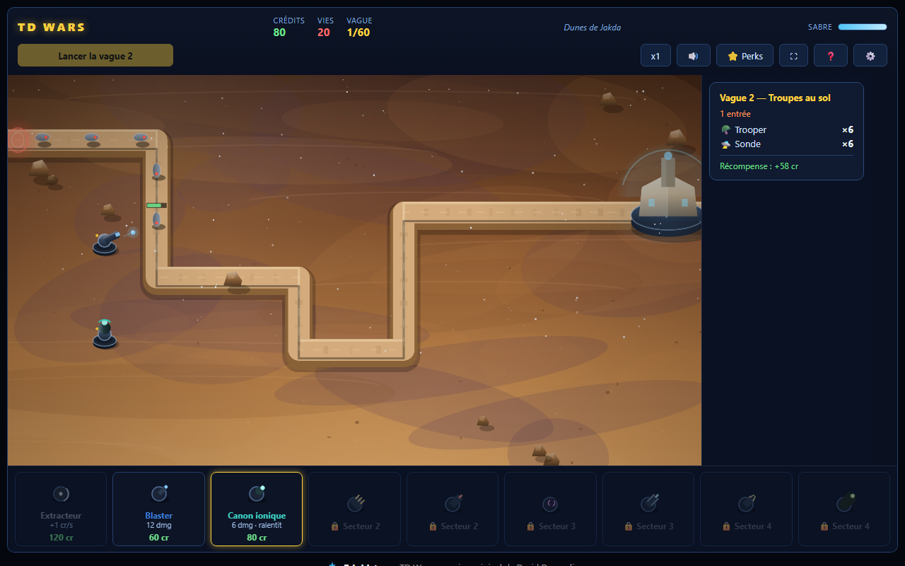

# TD Wars — Tower Defense

Tower defense spatial : **4 secteurs, 60 vagues, 9 armes, 18 spécialisations**, en TypeScript + Canvas 2D,
sans aucune dépendance à l'exécution. Rendu 2.5D : lumière unique, socles extrudés, décor pré-rendu par secteur.



🎮 **Jouer en ligne** : <https://fireman358.github.io/td-wars/>

## 🎮 Concept

Défendez votre **Base Étoilée** contre la flotte du **Nova Empire**. Placez des tours le long du
chemin, améliorez-les, choisissez leur spécialisation, gérez vos crédits, et survivez jusqu'au
boss final : le **Destroyer stellaire**.

Le labyrinthe est **regénéré à chaque partie** (graine aléatoire par run) : chaque tentative demande
de nouveaux placements.

## 🎚️ Difficulté

Réglable dans ⚙️ Paramètres et conservée d'une partie à l'autre. Le changement
s'applique aux vagues suivantes.

| Niveau | PV des ennemis | Vitesse | Vies | Crédits de départ |
|---|---|---|---|---|
| Facile | ×0,75 | ×0,95 | 25 | 260 |
| **Moyen** (défaut) | ×1,2 | ×1 | 18 | 220 |
| Difficile | ×1,45 | ×1,06 | 14 | 200 |

Les récompenses de vague suivent aussi le niveau (+15 % en facile, −0 % en
difficile). `npm run balance` imprime la courbe de difficulté des trois modes.

## 🛠️ Armes

Débloquées par secteur, trois niveaux chacune, puis une **spécialisation** au choix parmi deux.

| Tour | Rôle | Coût | Débloquée |
|------|------|------|-----------|
| Extracteur de moindal | Génère des crédits pendant les vagues | 120 cr | Secteur 1 |
| Blaster léger | Mono-cible rapide, polyvalent | 60 cr | Secteur 1 |
| Canon ionique | Ralentit les ennemis (zone) | 80 cr | Secteur 1 |
| Torpilles à proton | Dégâts de zone | 130 cr | Secteur 2 |
| Canon laser lourd | Gros dégâts mono-cible | 110 cr | Secteur 2 |
| Arc DEMP | Chaîne sur plusieurs cibles | 150 cr | Secteur 3 |
| Turbo-laser orbital | Très longue portée, frappe lourde | 200 cr | Secteur 3 |
| Rayon tracteur | Immobilise presque totalement | 420 cr | Secteur 4 |
| Canon axial | Superlaser de siège | 600 cr | Secteur 4 |

**Bonus d'adjacence** : +10 % de portée si une tour d'un *autre* type est placée juste à côté.

## 👾 Ennemis

Sonde éclaireuse, Trooper blindé, Intercepteur, Char des sables, Marcheur quadripode,
Bombardier furtif (difficile à cibler), Régénérateur (soigne ses alliés), Destroyer stellaire (boss).

Les ennemis blindés disposent d'un **bouclier d'énergie** (15 % des PV) que les grosses frappes
percent mieux que la mitraille.

## ⚙️ Lancer le jeu

```bash
npm install
npm run dev
```

Puis ouvrir <http://localhost:5173>. Build de production :

```bash
npm run build      # tsc (typecheck bloquant) + vite build
npm run preview
```

> ⚠️ Ne pas ouvrir `index.html` en double-clic : les modules ES sont bloqués en
> `file://` par les navigateurs. Passer par `npm run dev` (ou `npm run preview`),
> ou générer la version autonome ci-dessous.

## 📦 Version « double-clic »

```bash
npm run build:file   # produit td-wars.html (~100 Ko, tout intégré)
```

Un seul fichier HTML, scripts et styles inclus, sans module ES : il s'ouvre
directement dans le navigateur, sans serveur ni installation. Pratique pour
tester hors ligne ou envoyer le jeu à quelqu'un.

## 🧪 Outils

```bash
npm run typecheck  # TypeScript strict, sans émission
npm test           # tests du noyau (sauvegarde, réglages, méta, tracés, sabre, récap)
npm run balance    # harnais headless : DPS/crédit, courbe de difficulté, test de fumée du moteur
```

`npm run balance` compile le moteur en CommonJS dans `.tmp/` et simule les 60 vagues sans navigateur :
il vérifie que la simulation tourne, que le boss final reste battable avec le budget du joueur,
et affiche une table « dégâts par crédit » pour repérer les armes qui ne valent pas leur prix.

## 🕹️ Contrôles

- Clic sur une arme dans la barre du bas → puis clic sur le terrain pour la placer
- Clic sur une tour posée → panneau d'amélioration / spécialisation / ciblage / vente
- **Maintenir le clic** (ou le doigt) → sabrelaser, énergie limitée qui se recharge
- Clic droit, ou `Échap` → annuler la sélection / fermer un panneau
- **Lancer la vague** → démarre la vague suivante ; la lancer en avance rapporte un bonus
- Vitesse ×1 → ×4 (×10 en mode test)
- 📱 Souris, tactile et stylet passent par le même chemin de code (Pointer Events)

La partie en cours est **sauvegardée entre deux vagues** : fermer l'onglet ne fait plus perdre la run.

## 📁 Architecture

```
src/
  main.ts            composition : boucle, entrées, panneaux, cycle de vie
  render.ts          rendu canvas (décor, tours, ennemis, effets)
  style.css          feuille unique, palette en variables CSS
  game/
    config.ts        données : secteurs, tours, ennemis, générateur de vagues
    engine.ts        simulation pure, sans DOM
    tower.ts         entité tour + stats effectives mémoïsées
    enemy.ts         entité ennemi
    geom.ts          tracés, échantillonnage, PRNG déterministe
    run.ts           sauvegarde / reprise de la partie en cours
    storage.ts       localStorage validé, versionné, écriture différée
    meta.ts          méta-progression (perks) + migration
    settings.ts      préférences (audio, graphismes)
    sfx.ts           audio 100 % synthétisé (WebAudio, masterGain unique)
  ui/
    hud.ts           HUD incrémental + panneau de tour + arsenal
    overlays.ts      aide, réglages, perks, secteurs, écran de fin
    modal.ts         panneaux exclusifs, pause, Échap
    input.ts         Pointer Events unifiés
    icons.ts         icônes de l'arsenal (dessinées une fois)
tools/
  balance.ts         harnais d'équilibrage + test de fumée
  build-file.mjs     version mono-fichier jouable en double-clic
  tests/             tests du noyau (node:test, sans dépendance)
docs/                captures pour le README
public/              icônes, image de partage, manifeste
```

## 🌐 Déploiement

Le workflow `.github/workflows/deploy.yml` publie automatiquement sur GitHub Pages à chaque
push sur `main` (`npm ci` → `npm run build` → `actions/deploy-pages`).

Sur **Cloudflare Pages** : build command `npm run build`, output directory `dist`.

## 📄 Licence

MIT — voir [LICENSE](LICENSE).
